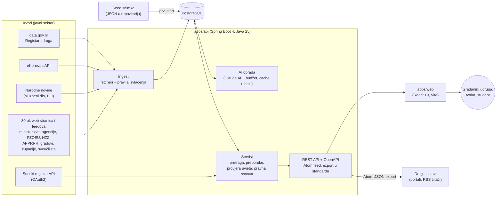

# Arhitektura: OtvoreniRadar

OtvoreniRadar skuplja javne natječaje i pozive iz više desetaka izvora javnog sektora RH, povezuje ih s propisima iz Narodnih novina i s profilom korisnika (OIB iz Sudskog registra ili Registra udruga). Uz to pomaže korisniku provjeriti ispunjava li uvjete natječaja. Ovaj dokument opisuje dijelove sustava, tok podataka, standarde i preduvjete za uvođenje.

## 1. Pregled

| Dio | Tehnologija | Uloga |
|---|---|---|
| Web (`apps/web`) | React 19, TypeScript, Vite, wouter, TanStack Query, axios | korisničko sučelje: preporuke, popis i detalj natječaja, provjera uvjeta, propisi, izvori |
| API (`apps/api`) | Spring Boot 4, Java 25, Spring Data JPA, Jsoup, PDFBox, Anthropic Java SDK | dohvat i obrada podataka, poslovna logika, REST API |
| Baza | PostgreSQL 17 (Docker), ekstenzija `unaccent` za pretragu bez dijakritika | natječaji, propisi, udruge, dnevnik dohvata, potrošnja LLM-a |
| AI | Claude API (Haiku za masovnu obradu, Sonnet za provjeru uvjeta) | izvlačenje polja, sažeci propisa, pitanja i presuda o uvjetima |

## 2. Moduli API-ja

Kod je podijeljen po domenama (`com.datathon.api.*`):

| Paket | Odgovornost |
|---|---|
| `ingest`, `ingest.source`, `ingest.extract`, `ingest.http` | dohvat s izvora (jedan fetcher po vrsti izvora), pravila za izvlačenje roka, iznosa, ciljne skupine i područja iz hrvatskog teksta, čitanje PDF-ova, HTTP klijent s `robots.txt` i cacheom |
| `fundingcall` | entitet natječaja, pretraga i filtri, fasete, oznaka duplikata, zatvaranje isteklih, Atom feed |
| `regulation`, `legalbasis` | propisi iz Narodnih novina, navodi propisa u tekstu natječaja i njihovo uparivanje s propisom |
| `profile` | profil iz OIB-a (Sudski registar ili Registar udruga), bodovanje i objašnjenje preporuka |
| `eligibility` | pitanja o uvjetima i provjera prihvatljivosti (AI + rezervna pravila) |
| `ai`, `integration.llm` | batch obrada Claude API-jem, sheme odgovora, budžet i evidencija troška |
| `integration.sudreg`, `integration.narodnenovine` | klijenti vanjskih API-ja |
| `association` | uvoz Registra udruga s data.gov.hr |
| `seed` | učitavanje i izvoz snimke baze (demo radi bez ključeva i bez interneta) |
| `standard`, `meta`, `source` | JSON Schema predloženog standarda, metapodaci, popis izvora i stanje dohvata |

## 3. Tok podataka

### 3.1 Dohvat (ingest)

1. **Pokretanje:** admin ruta `POST /api/admin/ingest`, pri startu (`INGEST_ON_STARTUP`) ili svaki dan u 5:30 (`INGEST_SCHEDULE_ENABLED`). Radi u pozadini i odmah vraća `202` s `runId`.
2. **Fetcheri** po vrsti izvora: JSON API (eKohezija, HZZ WordPress REST), RSS/Atom (Joomla, sveučilišta), HTML liste (Jsoup), CKAN resurs (Registar udruga). Generički fetcheri (WordPress, Joomla, EasyDNN, HTML lista) pokrivaju 36 gradova i županija istim kodom, pa se novi izvor dodaje jednim retkom konfiguracije.
3. **Pristojan dohvat:** poštuje se `robots.txt`, najviše 1 zahtjev u sekundi po izvoru, odgovori se spremaju u cache (`data/cache/`, 20 h). Izvori koji blokiraju AI crawlere se ne koriste.
4. **Izvlačenje pravilima** (`ingest.extract`): hrvatski datumi i rasponi rokova, iznosi (ukupno, najviše, najmanje), ciljne skupine, područja, županija. Tekst iz privitaka čita PDFBox.
5. **Upsert:** zapis se mijenja samo kad se promijeni SHA-256 teksta. Tada se AI rezultati brišu i ponovno računaju. Ručno provjerena polja ingest nikad ne gazi.
6. **Čišćenje:** objave koje nisu natječaji se skrivaju, duplikati između izvora se označavaju, a natječaji s prošlim rokom se zatvaraju (svaku noć u 00:05).
7. **Dnevnik:** za svaki izvor se bilježi koliko je zapisa dohvaćeno, koliko je novih, koliko promijenjenih i koliko grešaka (`source_run_log`). To se vidi na stranici „Izvori”.

### 3.2 AI obrada

| Korak | Model | Ulaz → izlaz |
|---|---|---|
| Izvlačenje polja | Haiku | tekst natječaja (i skenirani PDF kao dokument) → rok, iznosi, prijavitelji, područja, sažetak uvjeta, potrebni dokumenti |
| Pitanja o uvjetima | Haiku | tekst natječaja → do 5 kratkih pitanja (da/ne, broj) |
| Sažetak propisa | Haiku | tekst propisa iz NN → sažetak u nekoliko rečenica |
| Provjera uvjeta | Sonnet | odgovori korisnika i tekst natječaja → presuda (vjerojatno ispunjava / ne ispunjava / nejasno) s citatima iz teksta |

Načela:
- **Strukturirani izlaz:** svaki poziv ima JSON shemu odgovora, a odgovor se provjerava prije spremanja.
- **Izvor ima prednost:** strukturirani rok, status i županija iz izvora pobjeđuju ono što predloži model.
- **Cache u bazi:** masovni koraci se izvode jednom, batchom, a rezultat se sprema u bazu i u seed. Korisnik ih čita iz baze, bez poziva modela.
- **Budžet:** potrošnja se bilježi po pozivu (`llm_usage`) i staje na zadanom limitu (`LLM_BUDGET_USD`). Obrada cijelog seeda stajala je manje od 1 USD.
- **Uvijek radi:** bez ključa ili kad model ne odgovori, provjera uvjeta vraća rezervni odgovor iz pravila (rok, ciljna skupina, područje) s poveznicom na izvor.
- **Transparentnost:** AI podaci su u sučelju vizualno odvojeni od službenih podataka (oznaka „AI podaci”), a presuda ima citate i napomenu da nije pravni savjet.

### 3.3 Povezivanje podataka

| Spoj | Ključ | Što korisnik dobiva |
|---|---|---|
| OIB → Sudski registar | OIB | naziv, sjedište i županija, djelatnost (NKD) → profil za preporuke bez ručnog upisa |
| OIB → Registar udruga (data.gov.hr) | OIB | područja djelovanja udruge → preporuke za udruge |
| NKD → područja natječaja | mapiranje NKD odjeljaka | tvrtka vidi natječaje za svoju djelatnost |
| Natječaj → propis | broj NN + naziv propisa iz teksta | pravna osnova natječaja s poveznicom na propis (ELI), a na propisu popis natječaja koji ga navode |
| Natječaj ↔ natječaj | normalizirani naslov i izvor | isti poziv objavljen na više mjesta prikazuje se jednom |

Preporuke su objašnjive: svaki rezultat ima bodove i razloge („lokalno: Splitsko-dalmatinska”, „djelatnost NKD 62”, „rok za 12 dana”).

## 4. Web aplikacija

- Stranice: početna (unos profila ili OIB-a), preporuke, popis natječaja s filtrima, detalj natječaja s provjerom uvjeta, propisi, detalj propisa, izvori.
- Stanje s poslužitelja drži TanStack Query (cache, ponovni pokušaj samo za greške poslužitelja), rute su wouter.
- **Nema prijave ni korisničkih računa.** Profil se sprema samo u preglednik (`localStorage`) i šalje se API-ju samo za izračun preporuka. Poslužitelj ga ne pohranjuje.
- Dizajn sustav (`DESIGN_SYSTEM.md`): tokeni, pristupačnost (kontrast, fokus, semantički naslovi), prilagodba za mobitel, svako stanje (učitavanje, prazno, greška) ima svoj prikaz.
- U razvoju Vite proxy prosljeđuje `/api` na API. U produkciji web i API idu iza istog reverse proxyja: demo na https://otvoreniradar.zulja.org vrti se u Docker Composeu (PostgreSQL, API, Nginx) iza Cloudflare tunela.

## 5. API i interoperabilnost

Dokumentacija svih ruta je na `/swagger-ui.html` (OpenAPI 3, springdoc).

| Ruta | Opis |
|---|---|
| `GET /api/funding-calls` | pretraga i filtri (status, ciljna skupina, županija, područje, izvor, iznos, rok), stranice |
| `GET /api/funding-calls/{id}` | detalj s AI poljima, privicima i pravnom osnovom |
| `GET /api/funding-calls/facets` | brojevi za filtre |
| `GET /api/funding-calls/{id}/eligibility-questions`, `POST .../eligibility-check` | pitanja i provjera uvjeta |
| `POST /api/profiles/from-oib`, `POST /api/profiles/match` | profil iz OIB-a, preporuke |
| `GET /api/regulations`, `GET /api/regulations/{id}` | propisi i natječaji koji ih navode |
| `GET /api/sources` | izvori i stanje zadnjeg dohvata |
| `GET /api/funding-calls/feed.atom` | Atom feed novih natječaja za iste filtre kao popis |
| `GET /api/funding-calls/export` | izvoz u predloženom standardu „Otvoreni podaci o natječajima” |
| `GET /api/standard/funding-call.schema.json` | JSON Schema standarda |
| `/api/admin/*` (zaglavlje `X-Admin-Key`) | ingest, AI batchevi, izvoz seeda |

Korišteni standardi: OpenAPI 3, JSON Schema, Atom (RFC 4287), ELI (European Legislation Identifier) za poveznice na Narodne novine, OIB kao ključ subjekta, NKD 2007. za djelatnost, nazivi županija prema službenom popisu.

**Prijedlog standarda.** Glavni problem nije tehnički: natječaji se objavljuju kao HTML i PDF, svako tijelo na svoj način, a dio ključnih podataka (rok, iznos, prihvatljivi prijavitelji) dostupan je samo u slobodnom tekstu. Zato predlažemo jednostavnu shemu „Otvoreni podaci o natječajima”. Kad bi je tijela objavljivala na data.gov.hr, AI izvlačenje bi postalo nepotrebno. Polja `provider.oib` i `legalBasis.eli` označavaju podatke koje bi izdavatelj trebao navesti sam.

## 6. Kvaliteta i pouzdanost

- Više od 400 automatskih testova API-ja: jedinični testovi parsera na spremljenim stranicama izvora (fixturei) i integracijski testovi s bazom.
- `yarn build` (provjera tipova) i `yarn lint` za web.
- Greška jednog izvora ne ruši ingest: bilježi se u dnevnik, a ostali izvori se dohvaćaju dalje.
- Klijent Sudskog registra čuva OAuth2 token dok ne istekne i obnavlja ga sam.
- Provjera uvjeta ima ograničenje broja zahtjeva (`429`) radi zaštite troška.

## 7. Preduvjeti za uvođenje u stvarni rad

**Tehnički**
- Poslužitelj s Dockerom (PostgreSQL), JDK 25 i Node 22 za build weba. Opterećenje je malo: jedan dnevni ingest i statični web.
- Ključevi: Sudski registar (besplatna registracija), Claude API (neobavezno, procjena troška ispod 5 USD mjesečno za dnevne nove natječaje), `ADMIN_KEY`.
- Održavanje fetchera: kad izvor promijeni HTML, parser treba prilagoditi. Dnevnik dohvata to otkriva (nagli pad broja zapisa po izvoru).

**Organizacijski**
- Vlasnik usluge (npr. MPUDT kao vlasnik Portala otvorenih podataka) i osoba za praćenje dnevnika dohvata.
- Dugoročno: tijela objavljuju natječaje u predloženom standardu na data.gov.hr, pa se dohvat s web stranica postupno gasi.

**Pravni**
- Podaci s data.gov.hr koriste se prema Otvorenoj dozvoli RH, uz navođenje izvora. Za ostale izvore oslanjamo se na pravo na ponovnu uporabu informacija (Zakon o pravu na pristup informacijama), a stvarne licence treba potvrditi s izdavateljima (`DATA_SOURCES.md`).
- Osobni podaci: aplikacija ne pohranjuje korisnike. Iz Registra udruga spremamo samo OIB, naziv, sjedište, županiju, registarski broj i područja djelovanja, bez podataka o osobama.
- AI rezultat je informativan, ne pravni savjet. Sučelje to kaže i uvijek vodi na izvorni tekst natječaja.
- Tekst natječaja šalje se vanjskom AI servisu. Za produkciju u javnoj upravi treba ugovor o obradi podataka ili model koji radi na vlastitom poslužitelju (sučelje `LlmClient` to omogućuje bez promjene ostatka koda).

## 8. Poznata ograničenja i daljnji razvoj

Ograničenja:
- Dohvat s web stranica je krhak, a pokrivenost lokalne razine je djelomična (36 gradova i županija od 576 jedinica lokalne i područne samouprave).
- Kod dijela natječaja AI ne nađe rok jer ga nema u tekstu (npr. HZZ mjere „do iskorištenja sredstava”).
- Tekst nekih poziva je kratak, pa je presuda o uvjetima „nejasno”.

Daljnji razvoj:
- Obavijesti mailom i push porukom uz postojeći Atom feed.
- Više lokalnih izvora preko istih generičkih fetchera.
- Objava izvoza u predloženom standardu kao skupa podataka na data.gov.hr.
- Prijava s NIAS-om (e-Građani) za spremanje profila i povijesti prijava.
- Model koji radi na vlastitom poslužitelju za provjeru uvjeta.
